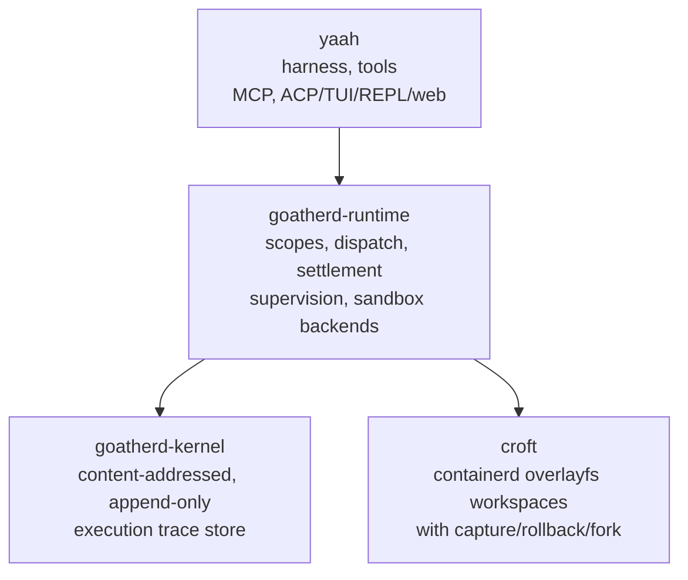

# Goatherd AI

A fast Go software stack for orchestrated AI agents that do real code work efficiently.

Everything here ships as source and plain binaries, keeps its state in files
you own (SQLite, git worktrees, containerd snapshots), and assumes no accounts,
no telemetry, and no hosted service.

## The farm

- **[yaah](https://github.com/goatherdai/yaah)** — a vendor-free
  agent harness. One Go binary holding the whole operation: agent harness,
  toolbelt, sessions and memory in local SQLite, and MCP as both client and
  server, plus any OpenAI-compatible API or the Anthropic Messages API.

  - **The goatherd — yaah's meta-agent.** The orchestrator you talk to: it plans
  and judges, dispatches specialists, and reviews everything before it reaches
  your tree.

  - **The herd — yaah's sub-agents.** The team the goatherd dispatches.
  Four roles are built in — `developer`, `analyst`, `tester`, and `reviewer` —
  and any number of custom roles can be added as markdown role files
  (`.agents/roles/*.md` per project, `~/.agents/roles/` for all projects).

- **The pasture** — where the herd works:

  - **[goatherd-kernel](https://github.com/goatherdai/goatherd-kernel)** — the layer
    underneath the agents: a content-addressed, append-only execution trace for agents.

  - **[goatherd-runtime](https://github.com/goatherdai/goatherd-runtime)** — the runtime
    adds execution scopes, the merge gate, settlement/recovery, sandbox backends (
    Landlock, Seatbelt, WinACL, croft), tasks,
    and supervision.

  - **[croft](https://github.com/goatherdai/croft)** — an isolated,
    snapshot-backed workspace on containerd's overlayfs snapshotter: provisioned
    from an image, worked in-band, and captured into states that outlive the
    sandbox — cheap checkpoints, exact O(1) rollback, and forks at layer-sharing
    cost. Linux-only, deliberately not a container runtime.

## How they stack

Each layer is usable on its own and honest about what it does not do. yaah
runs fine without croft (worktree isolation by default); croft knows nothing
about agents; goatherd-runtime steers scopes without caring which harness
created them.

## Principles

- **Vendor-free.** The stdlib first; every direct dependency earns its place.
  No SDKs that hide the wire format, no agent-platform accounts.
- **Your machine.** State lives in local files — SQLite, optional PostgreSQL, git worktrees,
  overlayfs layers — never behind someone's API.
- **Isolation you can name.** Where the host can confine a dispatch, it's
  kernel-enforced (Landlock, Seatbelt, or winacl) with a writable root the
  process chose; where it can't, the docs say so.
- **Reviewable by default.** Agents propose, the orchestrator disposes — a
  rejected attempt costs one dispatch and leaves your tree untouched.
- **Permissive licenses.** MIT (yaah is MIT OR Apache-2.0).
