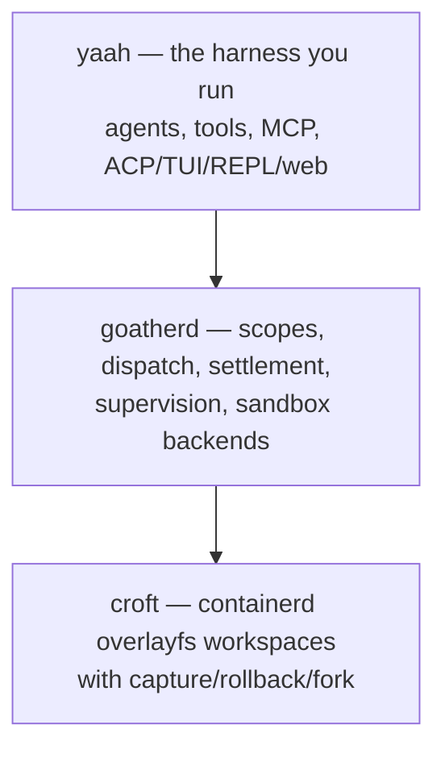

# Goatherd AI

A fast Go software stack for orchestrated AI agents that do real code work efficiently.

Everything here ships as source and plain binaries, keeps its state in files
you own (SQLite, git worktrees, containerd snapshots), and assumes no accounts,
no telemetry, and no hosted service.

## The herd

- **[yaah](https://github.com/goatherdai/yaah)** — a vendor-free agent harness.
  One Go binary orchestrates a team of AI coding agents: the orchestrator plans
  and judges, sub-agents research, implement, test, and review in parallel
  inside isolated worlds, and their work comes back as sealed proposals the
  orchestrator reviews before anything reaches your tree. Speaks any
  OpenAI-compatible API or the Anthropic Messages API, stores sessions and
  memory in local SQLite, and speaks MCP as both client and server.

- **[goatherd-kernel](https://github.com/goatherdai/goatherd-kernel)** — the layer
  underneath: a content-addressed, append-only execution trace for agents.

- **[goatherd-runtime](https://github.com/goatherdai/goatherd-runtime)** — the runtime
  adds execution scopes, the merge gate, settlement/recovery, sandbox backends (
  Landlock, Seatbelt, winacl, croft), tasks,
  and supervision.

- **[croft](https://github.com/goatherdai/croft)** — an isolated,
  snapshot-backed workspace on containerd's overlayfs snapshotter: provisioned
  from an image, worked in-band, and captured into states that outlive the
  sandbox — cheap checkpoints, exact O(1) rollback, and forks at layer-sharing
  cost. Linux-only, deliberately not a container runtime.

## How they stack

Each layer is usable on its own and honest about what it does not do. yaah
runs fine without croft (worktree isolation by default); croft knows nothing
about agents; goatherd steers scopes without caring which harness created
them.

## Principles

- **Vendor-free.** The stdlib first; every direct dependency earns its place.
  No SDKs that hide the wire format, no agent-platform accounts.
- **Your machine.** State lives in local files — SQLite, git worktrees,
  overlayfs layers — never behind someone's API.
- **Isolation you can name.** Where the host can confine a dispatch, it's
  kernel-enforced (Landlock, Seatbelt, or winacl) with a writable root the
